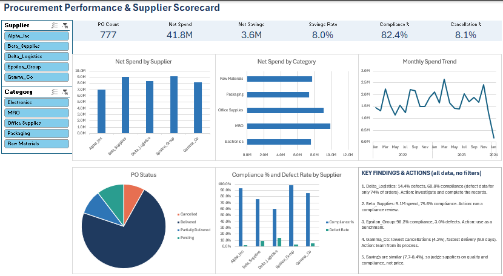
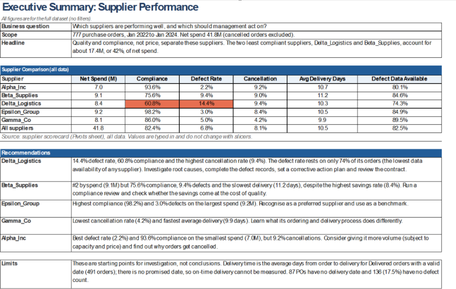
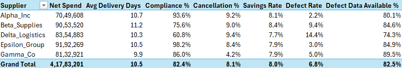
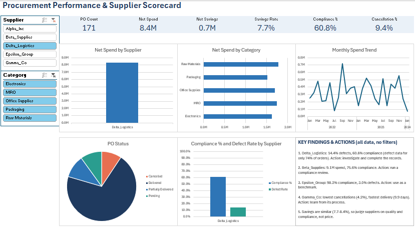
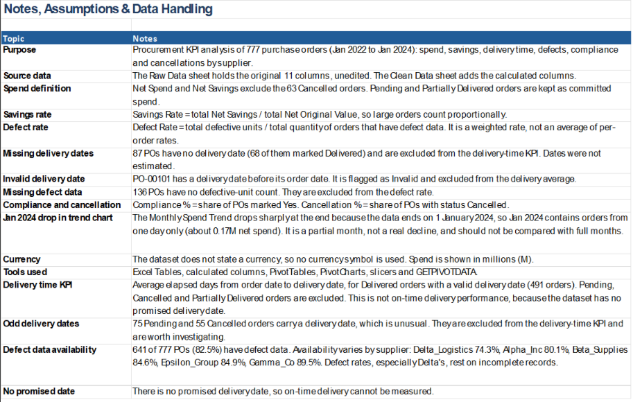
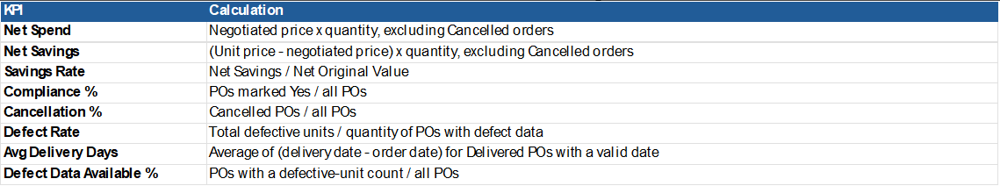
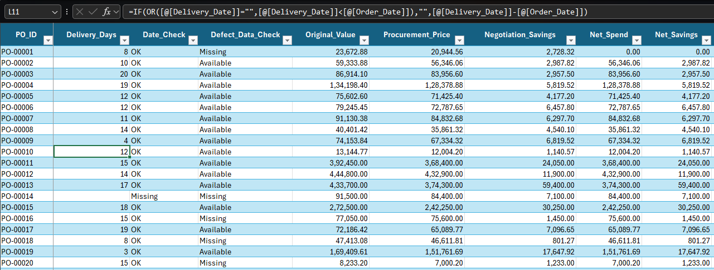
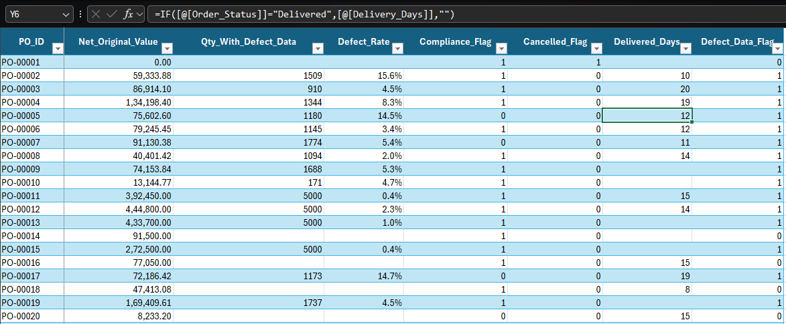

# Procurement KPI Dashboard (Excel)

An interactive Excel dashboard and executive summary analysing supplier performance, savings, delivery time, defects and compliance across 777 purchase orders (Jan 2022 to Jan 2024).

## Business question
Which suppliers are performing well, and which should management act on?

## Preview

## Headline finding
Quality and compliance, not price, separate these suppliers. The two least compliant suppliers, Delta_Logistics and Beta_Supplies, make up about 17.4M (42%) of net spend.

## Supplier comparison (all data)
| Supplier | Net Spend (M) | Compliance | Defect Rate | Cancellation | Avg Delivery Days | Defect Data Available |
|---|---|---|---|---|---|---|
| Alpha_Inc | 7.0 | 93.6% | 2.2% | 9.2% | 10.7 | 80.1% |
| Beta_Supplies | 9.1 | 75.6% | 9.4% | 9.0% | 11.2 | 84.6% |
| Delta_Logistics | 8.4 | 60.8% | 14.4% | 9.4% | 10.3 | 74.3% |
| Epsilon_Group | 9.2 | 98.2% | 3.0% | 8.4% | 10.5 | 84.9% |
| Gamma_Co | 8.1 | 86.0% | 5.0% | 4.2% | 9.9 | 89.5% |
| All suppliers | 41.8 | 82.4% | 6.8% | 8.1% | 10.5 | 82.5% |

## Recommendations (starting points for investigation, not conclusions)
- **Delta_Logistics:** investigate root causes, complete the defect records (its defect rate rests on only 74% of orders), set a corrective action plan and review the contract.
- **Beta_Supplies:** run a compliance review and check whether its high savings rate (8.4%) comes at the cost of quality.
- **Epsilon_Group:** recognise as a preferred supplier and use as a benchmark.
- **Gamma_Co:** learn what its ordering and delivery process does differently (lowest cancellations, fastest delivery).
- **Alpha_Inc:** consider giving it more volume (subject to capacity and price) and find out why orders get cancelled.

## Overall KPIs
| KPI | Value |
|---|---|
| Purchase orders | 777 |
| Net spend | 41.8M |
| Net savings | 3.6M |
| Savings rate | 8.0% |
| Compliance | 82.4% |
| Cancellation rate | 8.1% |
| Defect rate (weighted) | 6.8% |
| Avg delivery days (Delivered orders) | 10.5 |

## What I did
1. Kept the raw data untouched and worked in a separate Clean Data sheet (Excel Table).
2. Added calculated columns: delivery days, savings, net spend, defect rate, and compliance, cancellation and data-availability flags.
3. Flagged missing delivery dates, one invalid date and missing defect counts.
4. Built PivotTables, PivotCharts and slicers (Supplier, Category).
5. Linked the KPI cards to the pivots with GETPIVOTDATA so they update with the slicers.
6. Wrote the Executive Summary, assumptions and KPI definitions in the workbook.

## Assumptions and data handling
- Net spend and savings exclude the 63 cancelled orders. Pending and partially delivered orders are kept as committed spend.
- Savings rate and defect rate are weighted (total savings / total original value; total defective units / quantity with defect data).
- Delivery time is the average days from order to delivery for Delivered orders with a valid date (491 orders). There is no promised delivery date, so on-time delivery cannot be measured.
- 87 POs have no delivery date and one has a delivery date before its order date. 75 Pending and 55 Cancelled orders carry a delivery date, which is unusual. All are excluded from the delivery KPI.
- 136 POs (17.5%) have no defect count; availability varies by supplier (Delta_Logistics 74.3% to Gamma_Co 89.5%).
- January 2024 has one day of orders, so the drop at the end of the trend chart is a partial month, not a real decline.
- The dataset does not state a currency, so no currency symbol is used.

## More screenshots

## Files
- `Procurement_KPI_Dashboard.xlsx`: Executive Summary, Dashboard, Notes, Clean Data, Pivots, Raw Data
- `screenshots/`: PNG screenshots of the key sheets

## How to use
Download the `.xlsx` and open it in Excel. Use the Supplier and Category slicers on the Dashboard to filter the KPI cards and charts.

## Tools
Excel: Tables, calculated columns, PivotTables, PivotCharts, slicers, GETPIVOTDATA.

## Next steps
A SQL and Power BI project on a new dataset.

## Dataset
Procurement KPI Analysis Dataset by shahriarkabir on Kaggle:
https://www.kaggle.com/datasets/shahriarkabir/procurement-kpi-analysis-dataset

License: CC0 (Public Domain), as shown on the Kaggle page. The analysis, dashboard and recommendations are my own work.

## Author
[Nithesh Sai] | [LinkedIn](www.linkedin.com/in/nithesh-sai-30871b332)
